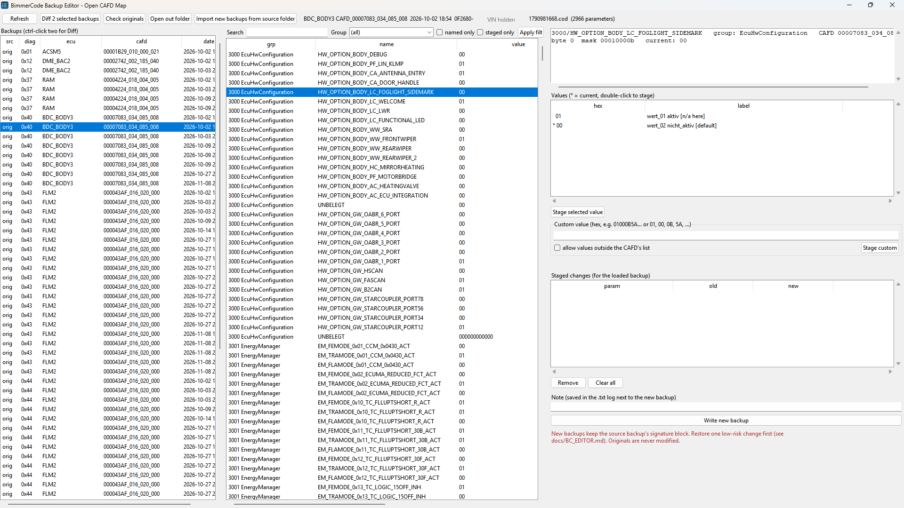

+++
title = "Using the editor"
weight = 2
+++

1. Pick a backup on the left. Use the newest one for the ECU you want to change.
2. Find the parameter with Search, Group, or "named only".
   - The details pane shows its position, mask, description and every value (`*` = current).
   - Long values (light curves, staging data) can be side-scrolled.
3. Double-click a value (or press "Stage selected value") to stage it.
   - A custom hex value needs "allow custom". It must have exactly the parameter's byte length; it's never padded.
   - Staged rows turn yellow.
4. Add a note, then press **Write new backup**. The new `.cod` goes to `out\` and opens, so you can check it or stage
   more on top of it.

Ctrl-click two backups and press **Diff** to see exactly which parameters differ.

New files are named like BimmerCode's (`<ECU>-<VIN>-<current unix time>.cod`), so they show up as the newest backup
for that ECU. Copy them to BimmerCode's backup folder on the phone and restore them in BimmerCode like any backup,
after reading [Before you restore](@/backup-editor/restoring.md).

## What the editor guarantees
- The new `.cod` is a byte copy of the source backup with **only the edited coding bytes changed**: same size, same
  plist structure, VIN, ECU and CAFD ids. Every write is re-read and checked, and discarded if anything else changed.
- Bit fields are edited bit-exactly (other bits in the same byte are kept).
- Multi-CAFD ECUs (BDC, ACSM, ...) are handled: every CAFD listed in the backup is used.
- SYSTEM datagroups (the NCD signature) can't be edited.
- `originals\` is never written.
