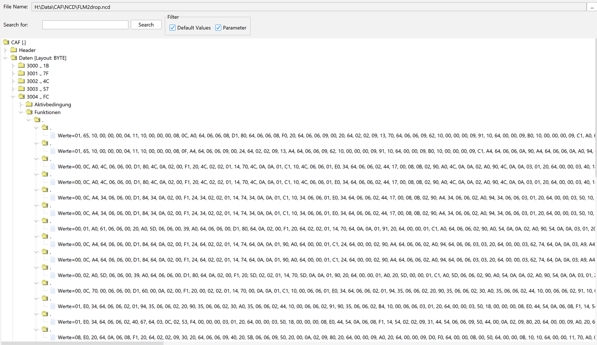
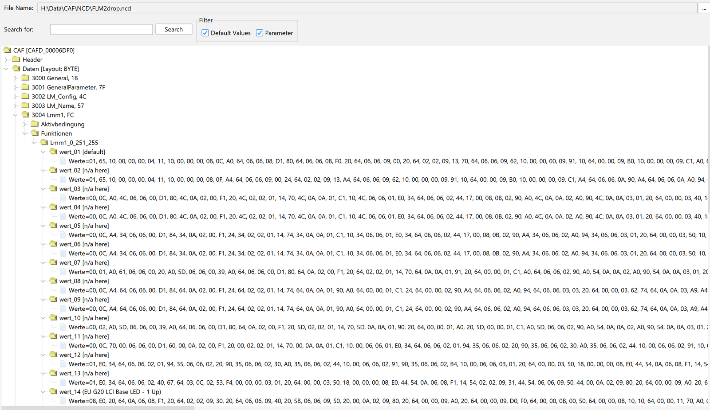

+++
title = "Names and labels"
weight = 1
+++

The same FLM2 NCD (CAFD 00006DF0) in E-Sys's FDL-Editor, first in stock E-Sys, then in E-Sys started from
OpenLauncher:

## Where the names come from
- **BMW's untrimmed names.** BMW's own group, function and value names (including the `aktiv` / `nicht_aktiv`
  labels of on/off options) from untrimmed CAFD dumps. They're keyed by each datagroup's exact function layout, so
  they apply to every software version with that layout and never land where bits moved.
- **Names from the community.** Names people have found from BimmerCode, screenshots, coding tables and backup diffs.
  Each name is keyed by CAFD id, datagroup, byte and mask, so it applies to every software version that has that
  function.
- **Contributed definition files and cheat sheets**, including the public community cheat sheets.
- **Value labels from BMW's coding rules.** Every value still carries the rule that selects it, and it's turned into
  readable text, for example `wert_02 [SA5AC]`: "value 2, coded when option 5AC is fitted". `[n/a here]` means the
  rule never applies to your reference vehicle class.
- **Option titles.** FP criteria show the factory option's title (`SA5AC High-beam assistant`).
- **BMW-style placeholders** for everything not named yet: `<Group>_<start>_<end>_<mask>`, for example
  `PfFesMaster_9_9_255`.

See [Names and definitions](@/names/_index.md) for coverage and how the sources rank.
