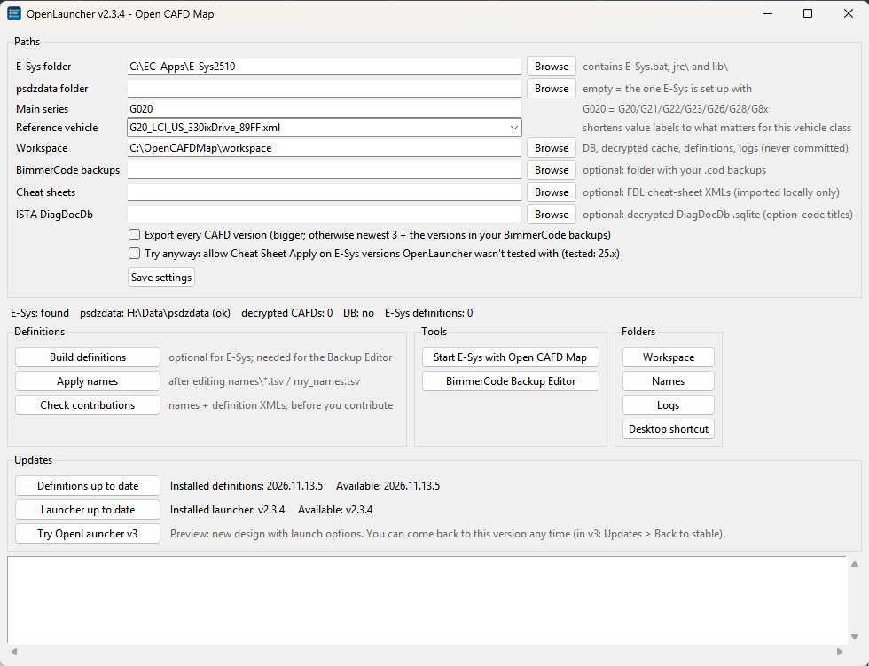
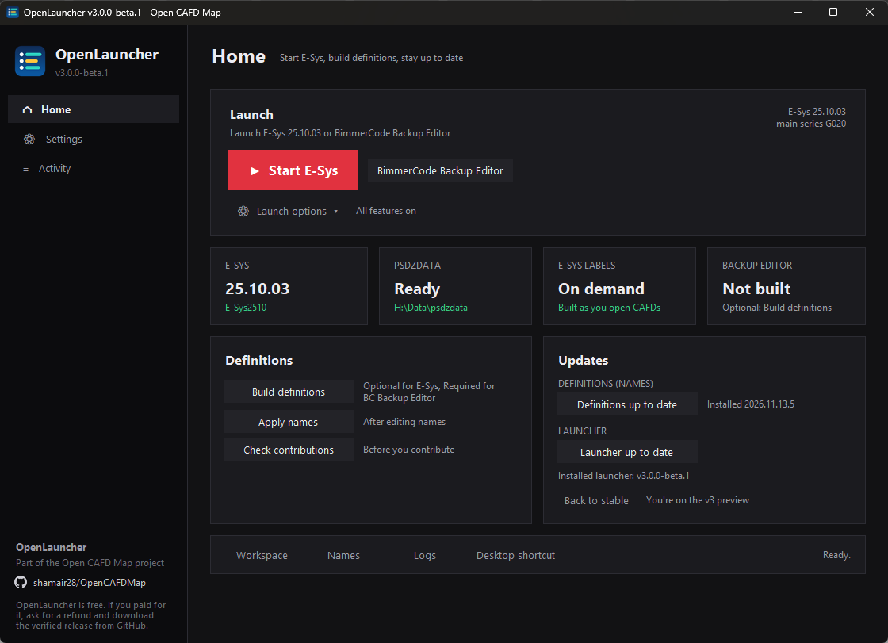

+++
title = "Home"
weight = 1
sort_by = "weight"
+++

**OpenLauncher** is a free launcher for modern versions of E-Sys. Its database has been brought up to date to cover
most G- and F-chassis coding definitions and parameters, along with FA / VO option codes.

It also adds a few quality-of-life features, all accessible from inside E-Sys:

- **Compare NCD**: two NCDs side by side, with the differences highlighted
- **Cheat Sheet**: cheat sheets right next to the FDL editor
- **FA / VO and SVT auto-backup**: every FA and SVT you read from the car is saved automatically

Where the database falls short, names and parameters are dynamically calculated to fill in the gaps.

<strong style="color: #1d7a43;">Compatibility</strong> 
Tested with <strong>E-Sys 25.10</strong> and <strong>E-Sys 3.35.3</strong> on Windows, with Python 3.10 or newer.
It <strong>should</strong> work on all Java 8 and Java 11 builds of E-Sys (<a href="../e-sys/versions/">check the version list</a>),
but universal compatibility hasn't been guaranteed yet.

*OpenLauncher v2.3.4 (current release)*

*OpenLauncher v3.0.0-beta.1 ([preview](@/updating/v3-preview.md))*

[Download OpenLauncher](https://github.com/shamair28/OpenCAFDMap/releases/latest) ·
[Getting started](@/getting-started/_index.md) ·
[GitHub](https://github.com/shamair28/OpenCAFDMap)

OpenLauncher is free. If someone sold it to you, ask for your money back and grab it from GitHub.

Not affiliated with BMW. Your psdzdata and coding data stay on your PC. Code at your own risk.
