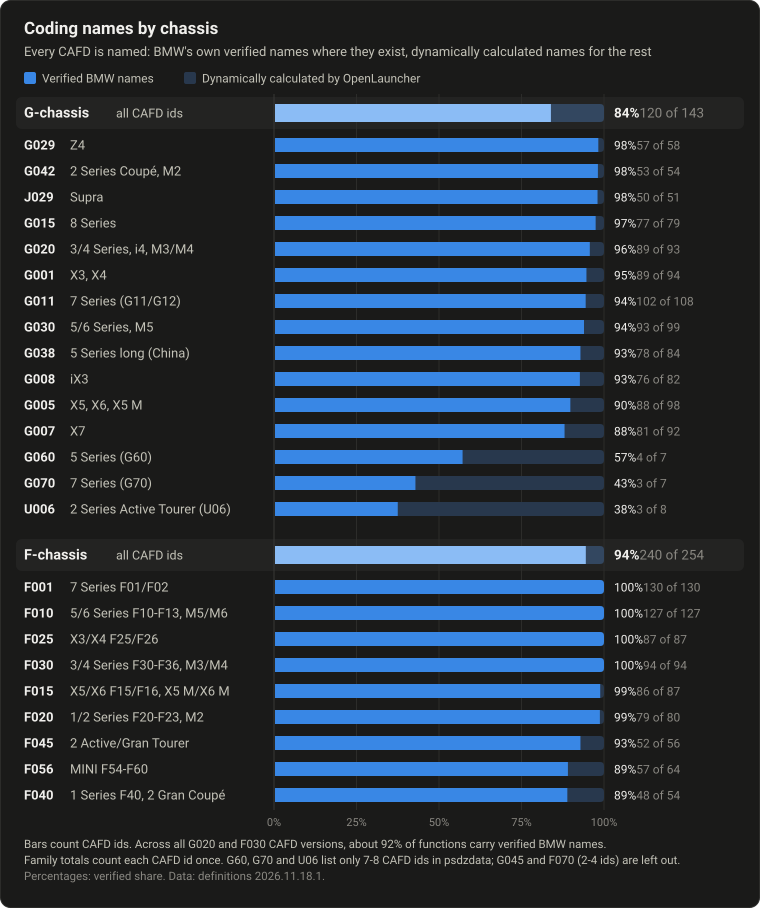

+++
title = "Coverage"
weight = 1
+++

Not in the chart: BMW i (I001), Rolls-Royce (RR01/RR11/RR21), Motorrad (K-series) and the other ranges in psdzdata,
where 151 of 193 CAFD ids (78%) have verified BMW names.

Every CAFD is named. BMW's untrimmed names cover about 249,000 functions, 530,000 values and 9,500 groups across 313
CAFD ids. For G020 and F030, about 92% of functions across every CAFD version carry these verified names.

OpenLauncher dynamically calculates the rest: functions are named from their group, byte and mask, and values are
labelled with their coding rules. Untrimmed dumps of CAFDs your series doesn't share with G020 or F030 raise its
coverage the most; see [Contributing](@/contributing/_index.md).

OpenLauncher works with any main series: set it in [Settings](@/getting-started/settings.md).
