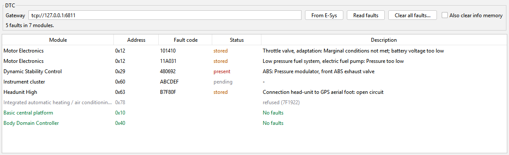
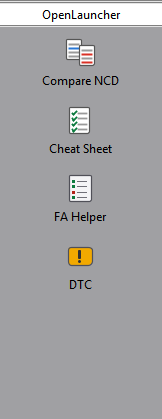

+++
title = "DTC"
weight = 5
+++

**v3.** DTC is part of [OpenLauncher v3](@/updating/v3-preview.md), currently a release candidate.

Read the car's fault codes (DTCs) in E-Sys, and clear them after coding. E-Sys doesn't clear faults after **Code**;
BimmerCode does, and DTC does the same.

## Read faults
Connect E-Sys to the car as usual (**Open Connection**), open **DTC** in the OpenLauncher section and press
**Read faults**. Every module that answers is listed:

| Column | |
|---|---|
| **Module** | The module's name from E-Sys's SVT when you've read it, otherwise its usual name at that address |
| **Address** | The module's diagnostic address |
| **Fault code** | The code as the module reports it |
| **Status** | **present**: the fault is there right now. **stored**: it was there and is remembered. **pending**: it was seen but isn't confirmed yet |
| **Description** | The fault's text, in English or German (follows E-Sys's language). `-` when there's no text for that code |

Modules with faults come first, then modules that refused the request, then modules without faults (green).

Where ISTA has more than one text for a code at that address (different generations of a module), the most common is
shown and the others are in its tooltip.

## Clear all faults
Press **Clear all faults...** and confirm. DTC sends one "clear all faults" request to every module (`14 FF FF FF`),
the same request BimmerCode sends after coding, and then reads the faults again. A module that doesn't answer gets the
request on its own.

- Faults that are still there come back: clearing only removes what's stored. Fix the cause first.
- **Also clear info memory** (off by default) also clears BMW's info memory (Infospeicher), which keeps notes that
  aren't faults.
- Coding data, the FA and the SVT aren't touched.

## The connection
DTC uses the car E-Sys is connected to. A car's gateway takes one diagnostic connection at a time, so while E-Sys is
connected, DTC borrows E-Sys's connection for a moment: it closes it, reads or clears, and opens it again with the
same settings. You don't need to do anything. If E-Sys's connection can't be opened again, DTC says so: use
**Open Connection** in E-Sys.

- The **Gateway** field shows the address DTC used. **From E-Sys** fills it from E-Sys's connection; you can also type
  an address, for example `tcp://169.254.0.8:6801`.
- DTC doesn't start while E-Sys is busy (coding, flashing).

## Fault texts
The texts ship with Open CAFD Map in `data\dtc\`, built from ISTA, and update through **Check for updates** in
OpenLauncher. Nothing from ISTA is needed on your PC.

## Status
DTC has been tested with FakeCar, not yet on a real car. Feedback from a real car is very welcome:
[Feedback discussion](https://github.com/shamair28/OpenCAFDMap/discussions/1).
