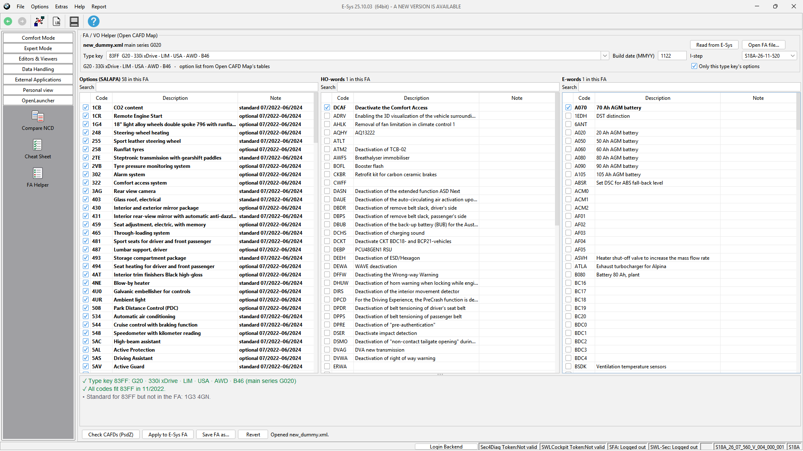
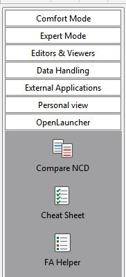
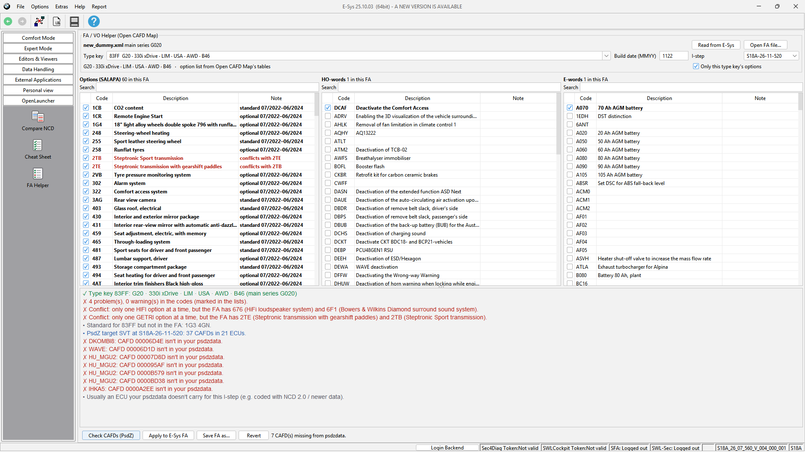
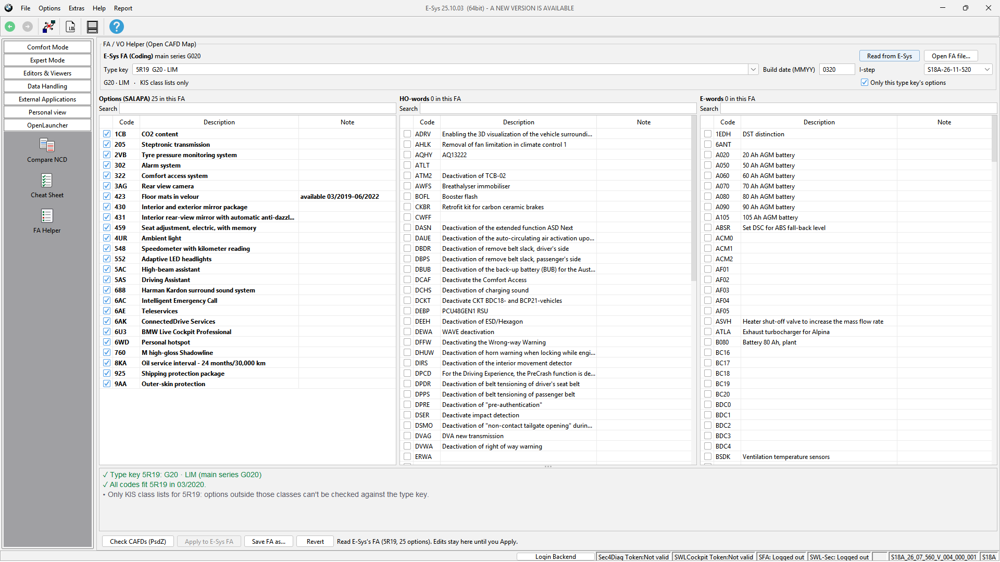

+++
title = "FA Helper"
weight = 4
+++

**v3.** The FA Helper is part of [OpenLauncher v3](@/updating/v3-preview.md), currently a release candidate.

A vehicle order (FA / VO) editor inside E-Sys. Options (SALAPA), HO-words and E-words are tick lists with their
titles, and every change is checked as you make it: is the option offered for this type key and build date, does it
clash with another option, and does your psdzdata have every CAFD the FA calls for.

## Getting an FA in
- **Read from E-Sys** takes the FA E-Sys has open: in **Coding** (read from the car or loaded) or in the
  **FA editor**. If both have one, the helper asks which, and shows where it came from.
- **Open FA file...** loads an FA from disk.

Your edits stay in the helper until you apply them.

## What's checked

| Check | What you see |
|---|---|
| Type key | Its series, model, body, market, drive and engine. Unknown type keys are flagged. |
| Build date | Flagged when it's outside the type key's production. |
| Option offered for the type key | Red: "not offered for 83FF". Each option shows whether it's standard or optional, and when. |
| Option available at the build date | Orange: "not available in 01/2019". |
| Conflicts | Two options from one class, such as two transmissions (2TE and 2TB) or two sound systems, are flagged. A few classes where the factory does combine options (for example some mirror packages) give a warning instead. |
| Standard options missing | Listed, so you can see what the type key normally comes with. |

**Only this type key's options** narrows the list to what the type key offers. Untick it to add any option.

## Check CAFDs (PsdZ)
Calculates the target SVT for the edited FA with E-Sys's own PsdZ, at the **I-step** you pick (the ones PsdZ offers
for the FA). It lists every CAFD the FA calls for that your psdzdata doesn't have, and the option that brought it in
when you added one. Usually that's an ECU your psdzdata doesn't carry for that I-step, for example one coded with
NCD 2.0 or newer data.

## Apply and save
- **Apply to E-Sys FA** hands the edited FA back to where it came from (Coding or the FA editor). E-Sys marks it
  "File updated, not saved yet" and recalculates the vehicle profile. Saving it and writing it to the car stay in E-Sys,
  as usual. The helper never writes to the car.
- **Save FA as...** writes it to a file instead.
- **Revert** goes back to the FA as you read it.

## Type keys with fewer details
For some type keys (often older ones) only KIS's class lists are available. The helper says so, and checks the
options it can (conflicts, the classes the type key allows, availability windows).

## Where the data comes from
Everything the checks need ships with Open CAFD Map in `data\fa\`: 8,456 type keys with their options and production
windows, option classes, and titles for options, HO-words and E-words. It updates through **Check for updates**, so it
doesn't depend on how old your psdzdata is. Only **Check CAFDs** uses your own psdzdata, through E-Sys's PsdZ.
